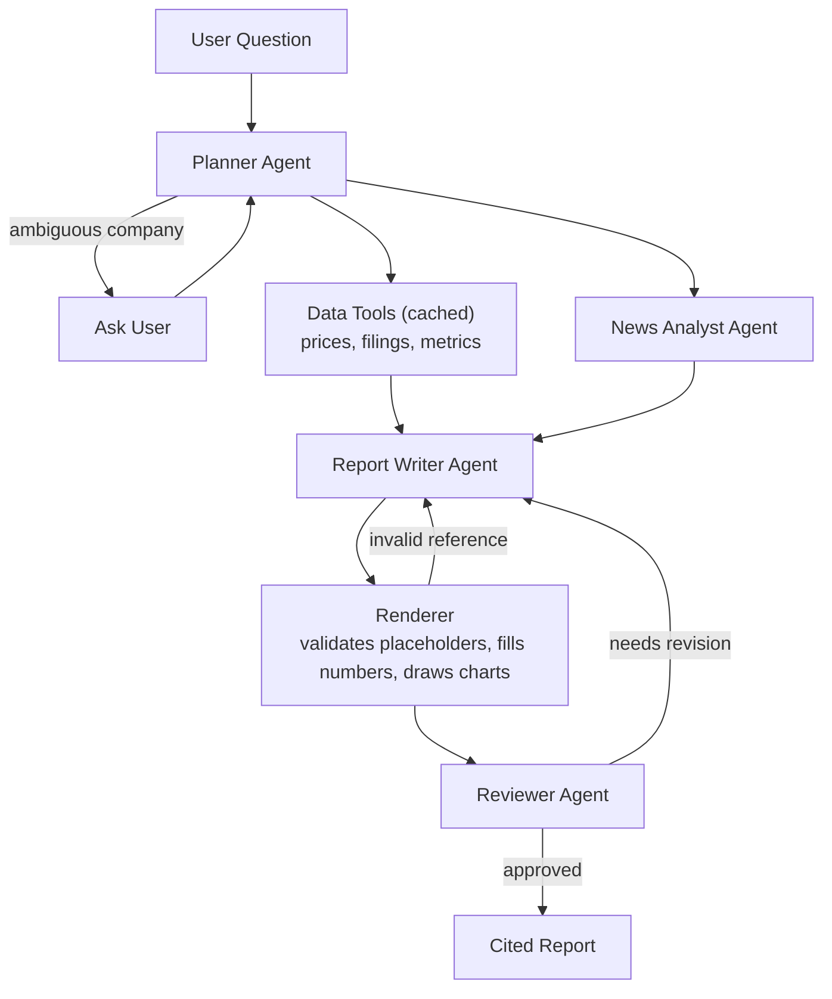

# StockCiteAI

**An agentic AI system where specialized agents plan, research, write, and review answers about any US-listed company, with every number cited from real data.**

> StockCiteAI explains what has happened to a company using real data. It does not predict prices or give investment advice.

---

## Problem Statement

When someone wants to understand how a public company is doing, they usually have two options, and both fall short:

1. **Manual research.** Checking price charts, reading regulatory filings for revenue and profit, and searching the news for recent events. This takes hours and requires financial knowledge.
2. **General-purpose AI chatbots.** Fast, but they often produce outdated or fabricated numbers, confuse companies with similar names, and provide no sources, so the answers cannot be trusted.

**StockCiteAI solves this with a team of specialized AI agents that turn a plain-English question into a short, cited report, where every number comes from real data and every claim is reviewed before it reaches the user.**

---

## What StockCiteAI Does

- Accepts plain-English questions such as *"How is Nvidia doing this year?"* or *"Why did Tesla stock drop last week?"*
- Identifies the correct company and asks the user to choose when the name is ambiguous.
- Plans which data the question needs and fetches only that.
- Calculates all financial metrics in code, never with the language model.
- Finds and filters news that is genuinely about the company.
- Writes a report where every number is inserted from verified data and every source is cited.
- Reviews each claim against the data and revises the report when needed.
- Supports follow-up questions within the same conversation.

---

## Agentic Capabilities

| Capability | How StockCiteAI uses it |
|---|---|
| **Planning** | The Planner Agent turns each question into a structured plan and routes work only to the components needed |
| **Tool use** | Agents call external tools to resolve companies, search news, and fetch articles |
| **Iterative reasoning** | The News Analyst judges results and rewrites its search when relevant articles are missing |
| **Parallel execution** | Data collection and news analysis run at the same time |
| **Self-correction** | The Reviewer Agent critiques the report and sends it back to the Writer for revision |
| **Human-in-the-loop** | The system pauses to ask the user when a company name is ambiguous |
| **Memory** | Conversation state persists, so follow-up questions reuse earlier context and data |
| **Guardrails** | Numbers come only from verified data, outputs are schema-validated, and no model-generated code is executed |

---

## Architecture

All agents share a single typed state managed by LangGraph. Each agent receives the state fields it needs directly in its prompt, so tools are reserved for reaching external systems. The review loop is capped at two revisions; unresolved claims are shown with warnings.

All external data is cached with expiry times matched to how often it changes: filings until a new one is published, price data until the next market close, and news for one hour. This keeps reports fast, makes follow-up questions nearly instant, and stays within data provider rate limits.

---

## Agents and Components

### 🧭 Planner Agent
| | |
|---|---|
| **Role** | Understands the question and decides what work is needed |
| **Input** | User question, conversation history |
| **Tools** | `resolve_company` |
| **Output** | Structured plan: company, intent, required data, time period, scope check |

Simple questions skip unnecessary steps, and requests for predictions or advice are recognized as out of scope.

### 📰 News Analyst Agent
| | |
|---|---|
| **Role** | Finds news genuinely about the company and summarizes it |
| **Input** | Company profile, time period from the plan |
| **Tools** | `search_news`, `fetch_article` |
| **Output** | Key events and overall tone, each with a source link |

Filters out irrelevant results (such as fruit articles for "Apple") and rewrites its search when too few relevant articles remain.

### ✍️ Report Writer Agent
| | |
|---|---|
| **Role** | Writes the answer and requests charts |
| **Input** | Plan, metrics manifest, news summaries |
| **Tools** | None |
| **Output** | Report text with placeholders, chart requests as JSON |

Never types numbers. It references verified values through placeholders like `{revenue_yoy_growth}`, can only use keys listed in the metrics manifest, and states clearly when a metric is unavailable.

### 🔍 Reviewer Agent
| | |
|---|---|
| **Role** | Checks every claim before the report reaches the user |
| **Input** | Rendered report, metrics manifest, news summaries |
| **Tools** | None |
| **Output** | Approval, or specific feedback for the Writer |

Catches statements like "revenue grew strongly" when growth was 1%, causes that no news supports, or answers that use the wrong metric or period.

### ⚙️ Data Tools (code)
Fetch price history and financial filings, choose industry-appropriate metrics (banks and insurers use different metrics than tech companies), calculate everything in code, and produce a **metrics manifest** listing each available metric with its value, unit, period, and source, plus unavailable metrics with reasons.

### ⚙️ Renderer (code)
Validates every placeholder and chart request against the manifest, fills in real formatted values, and draws charts with fixed plotting code. Invalid references are sent back to the Writer.

---

## AI Evaluation

StockCiteAI is evaluated at two levels: **each agent on its own**, and **the full system end to end**. Evaluation runs on **LangSmith**: every run is traced, so each score can be traced back to the exact prompts, tool calls, and outputs that produced it.

### Evaluation Dataset

A fixed set of questions across a diverse group of companies, including large and small companies, banks and insurers, foreign companies listed in the US, and recent IPOs. Questions cover every type the system supports:

- Overview, single-metric, and "explain a price move" questions
- Follow-up questions
- Ambiguous company names
- Out-of-scope requests (predictions and investment advice)

Each question has hand-labeled expected results: the correct company, intent, required metrics, and periods. The dataset is stored as a versioned LangSmith dataset.

### Agent-Level Evaluation

| Agent | What is measured | Method |
|---|---|---|
| **Planner** | Intent accuracy, plan correctness, out-of-scope detection | Compared against hand-labeled plans |
| **Company resolution** | Correct company, ambiguity detection | Compared against labeled companies |
| **News Analyst** | Relevance precision, search retries needed | Human-labeled sample of returned articles, reviewed in LangSmith annotation queues |
| **Report Writer** | Correct metric and period selection, valid placeholders on first attempt, handling of unavailable data | Compared against expected metrics |
| **Reviewer** | Detection rate of seeded errors, false alarm rate | Known false claims are injected into reports to test whether the Reviewer catches them |

### End-to-End Evaluation

| Metric | Description | Method |
|---|---|---|
| **Completion rate** | Reports generated without errors | Automated |
| **Faithfulness** | Claims supported by the collected data and news | LLM-as-judge, validated against human labels on a sample |
| **Answer relevance** | Report directly answers the question asked | LLM-as-judge, validated against human labels on a sample |
| **Citation coverage** | Numbers and claims linked to a source | Automated |
| **Revision rate** | Reports needing one or more Reviewer revisions | Automated |
| **Latency** | Median and 95th-percentile time per report, with and without cache | Automated |
| **Cost** | Average model cost per report | Automated |

### Baselines and Ablations

To show that each design choice matters, the full system is compared against the following variants, each run as a LangSmith experiment on the same dataset and compared side by side:

- **Single-agent baseline:** one agent with all tools answers the question directly
- **Without Reviewer:** reports go straight to the user
- **Without placeholders:** the Writer types numbers itself

### Regression Testing

The evaluation suite runs whenever prompts, models, or agent logic change, so improvements in one area do not silently break another. Results are tracked over time to compare versions.

---

## Tech Stack

| Layer | Technology |
|---|---|
| Language | Python |
| Agent Orchestration | LangGraph |
| Language Models | OpenAI |
| Tracing and Evaluation | LangSmith |
| Backend | FastAPI |
| Frontend | Streamlit |
| Validation | Pydantic |
| Database and Caching | PostgreSQL |
| Deployment | Docker |
